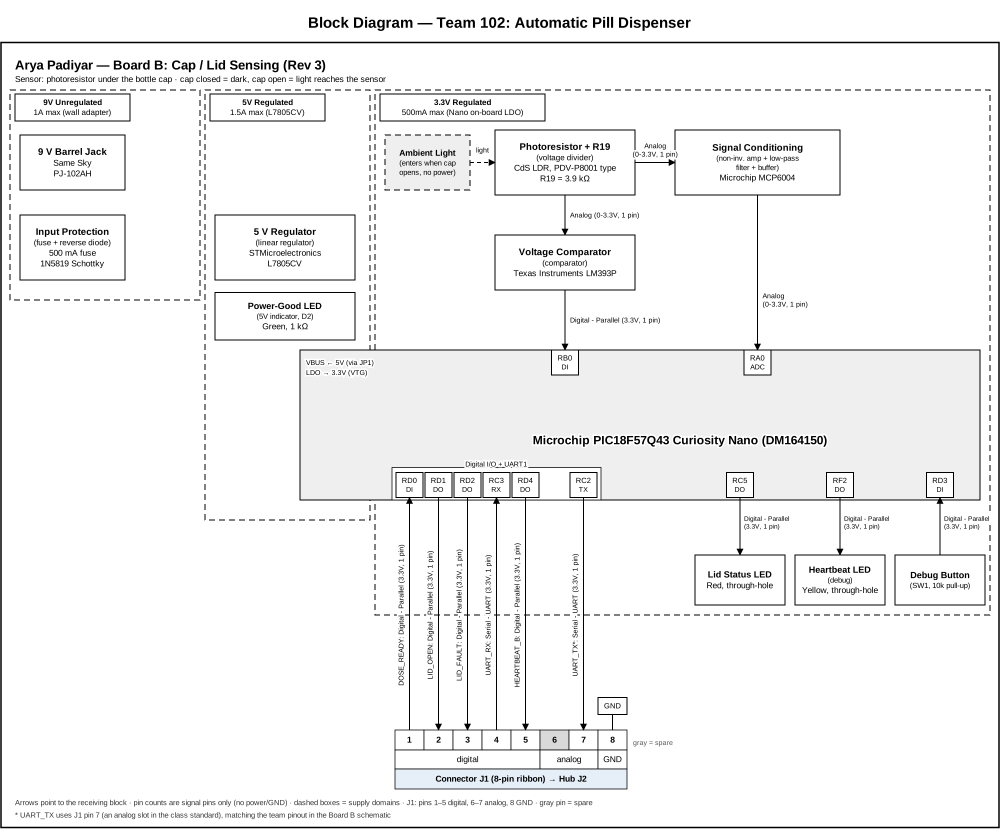

## Overview

**Arya Padiyar — Team 102: Automatic Pill Dispenser**
**Subsystem: Board B — Cap / Lid Sensing (Rev 3)**

This block diagram shows how my subsystem, Board B, is laid out and how it connects to the team's hub board.

- **Power levels:** A 9V wall adapter enters through a DC barrel jack, then a 500 mA fuse and a 1N5819 reverse-polarity diode. An L7805CV linear regulator steps it down to 5V, which feeds the PIC18F57Q43 Curiosity Nano's VBUS through jumper JP1. The Nano's on-board LDO supplies 3.3V (VTG) to the sensor, op-amp, comparator and all logic, so no signal can go above the PIC's 3.3V pin limit.
- **Sensor:** A photoresistor (the same light-dependent resistor from our Resistive Sensor Lab) sits under the bottle cap in a voltage divider with R19 = 3.9 kΩ. With the cap closed the sensor is dark (high resistance, low voltage). When the cap opens, light reaches it and the divider voltage rises.
- **Signal chain:** The divider output goes two ways. One path runs through an MCP6004 non-inverting amplifier, a low-pass filter (fc ≈ 15.9 Hz) and a unity-gain buffer into the ADC on RA0, so I can read the actual light level. The other path goes to an LM393 comparator, which gives a clean open/closed digital signal on RB0.
- **Outputs and debug:** A red lid status LED on RC5, a yellow heartbeat LED on RF2, a debug push button on RD3, and a green power-good LED on the 5V rail.
- **Team connections:** Board B connects to the hub (J2) through 8-pin ribbon connector J1. I use pins 1–5 and 7 for signals, pin 8 for GND, and pin 6 is spare.

## Block Diagram

Source files: [block diagram source (.drawio + .svg)](block-diagram-source.zip). Related pages: [Component Selection](../02-Component-Selection/Component-Selection.md) · [Schematic](../04-Schematic/schematic.md) · [Power Budget](../05-Power-Budget/Power-Budget.md)

## What changed since the last version

| Change | Why |
|---|---|
| Replaced the linear Hall-effect sensor (DRV5055) and cap magnet with a photoresistor + 3.9 kΩ (R19) voltage divider | Recommended by the teaching team (Zane Reynolds and Dr. Nichols, Oct 21). It still meets the analog-sensor requirement and works the same way (analog value → ADC + comparator), but it doesn't need a magnet mounted in the cap. It also reuses a circuit we already built and characterized in the light lab. |
| Added the MCP6004 signal-conditioning block (amplifier, low-pass filter, buffer) | The schematic already had this stage; the diagram now matches it. |
| Added input protection (fuse + reverse diode) and JP1 to VBUS | Matches the schematic's power section. |
| Added UART_RX (pin 4) and UART_TX (pin 7) to J1, the heartbeat LED, the debug button and the power-good LED | Matches the team pinout and the debug features in the schematic. |
| Removed the power arrows | Power is shown by the dashed supply-domain boxes, as the block diagram checklist requires. |

## How I structured the diagram

I grouped every block by the supply rail it runs on (9V, 5V, 3.3V dashed boxes) so the power path reads left to right: wall adapter → protection → regulator → Nano. The sensing path then reads left to right along the top (light → divider → conditioning → MCU), and everything that leaves the board goes straight down to J1, so each ribbon pin lines up with the MCU pin that drives it. Arrows always point at the receiving block, which makes the direction of each team signal obvious during review.

## How it meets the product requirements

- **Detect when the cap is opened:** the divider voltage rises sharply when light reaches the sensor. From my light-lab measurements (46.3 kΩ covered, 11.07 kΩ low light, 1.54 kΩ room light), the divider gives about 0.26 V with the cap closed and 0.86–2.37 V with the cap open on the 3.3 V rail.
- **Analog signal chain:** RA0 reads the conditioned light level, so firmware can tune the open/closed threshold and flag LID_FAULT when the reading is outside the expected range (for example, stuck at the 3.3 V rail).
- **Reliable digital state:** the LM393 with hysteresis gives the hub a clean LID_OPEN signal without chatter at the threshold.
- **Safe logic levels:** every analog part runs from 3.3 V, so nothing can exceed the PIC's pin limits.

## Connector J1 → Hub J2

| J1 Pin | Signal | Direction | MCU Pin | Type |
|---|---|---|---|---|
| 1 | DOSE_READY | Hub → Board B | RD0 (DI) | Digital - Parallel (3.3V, 1 pin) |
| 2 | LID_OPEN | Board B → Hub | RD1 (DO) | Digital - Parallel (3.3V, 1 pin) |
| 3 | LID_FAULT | Board B → Hub | RD2 (DO) | Digital - Parallel (3.3V, 1 pin) |
| 4 | UART_RX | Hub → Board B | RC3 (UART1 RX) | Serial - UART (3.3V, 1 pin) |
| 5 | HEARTBEAT_B | Board B → Hub | RD4 (DO) | Digital - Parallel (3.3V, 1 pin) |
| 6 | — | Spare (analog) | — | — |
| 7 | UART_TX | Board B → Hub | RC2 (UART1 TX) | Serial - UART (3.3V, 1 pin) |
| 8 | GND | — | GND | — |

## Major Components

| Function | Manufacturer | Part Number | Supply |
|---|---|---|---|
| Microcontroller | Microchip | PIC18F57Q43 Curiosity Nano (DM164150) | 5V in / 3.3V logic |
| Photoresistor (light sensor) | Advanced Photonix (equivalent) | CdS LDR, PDV-P8001 type, with R19 = 3.9 kΩ | 3.3V |
| Op-amp (amp, filter, buffer) | Microchip | MCP6004 | 3.3V |
| Voltage comparator | Texas Instruments | LM393P | 3.3V |
| 5V linear regulator | STMicroelectronics | L7805CV | 9V in / 5V out |
| Reverse-polarity diode | — | 1N5819 Schottky | 9V |
| Input fuse | — | 500 mA slow-blow, TR5 socket | 9V |
| DC barrel jack | Same Sky | PJ-102AH | 9V |
