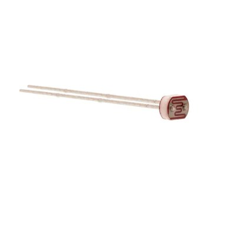
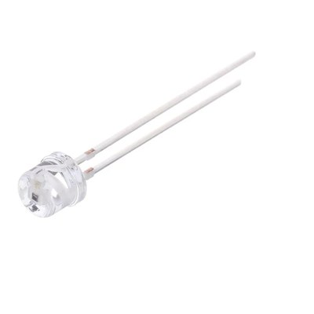

**Arya Padiyar | Team 102 | Board B: Cap / Lid Sensing**

Board B detects when the pill bottle cap is opened. A photoresistor under the cap sits in the dark while the cap is closed; when the cap opens, light reaches it, its resistance drops and the divider voltage rises. An MCP6004 op-amp chain conditions that voltage for the PIC's ADC, an LM393 comparator turns it into a clean open/closed signal, and a linear regulator supplies the board from an external wall supply. The microcontroller (PIC18F57Q43 Curiosity Nano) was selected by the course and is not compared here.

> **Rev 3 update (Oct 27):** the lid sensor changed from a DRV5055 Hall-effect sensor + cap magnet to a photoresistor. The teaching team (Zane Reynolds, after discussing it with Dr. Nichols) recommended the photoresistor because it meets the analog-sensor requirement, works the same way (analog value into the ADC and the comparator), and does not need a magnet in the cap. It is also the sensor we already built and characterized in the Resistive Sensor Lab. The Hall sensor is kept below as Option 3 to show why it was replaced.

---

## 1. Lid Sensor (Light Sensor)

**Subsystem: Board B – Cap / Lid Sensing**

| Solution | Pros | Cons |
|---|---|---|
| { width="150" } **Option 1.** CdS photoresistor (LDR), 5 mm, e.g. Advanced Photonix PDV-P8001, in a divider with a 3.9 kΩ resistor $1.42/each (lab kit part used for testing) [PDV-P8001 at Mouser](https://www.mouser.com/ProductDetail/846-PDV-P8001) · [datasheet](https://faculty-web.msoe.edu/prust/EE2920/EE2920Resources/PDV-P8001.pdf) | \* Already characterized in our Resistive Sensor Lab: 46.3 kΩ covered, 11.07 kΩ low light, 1.54 kΩ room light, 66.5 Ω bright light \* With R19 = 3.9 kΩ on 3.3 V the divider gives 0.26 V with the cap closed and 0.86–2.37 V with it open, a large, easy-to-detect step that never exceeds the PIC's 3.3 V ADC input \* Gives an analog signal, so it meets the project's analog signal-chain requirement \* No magnet or extra part in the cap; two leads, no polarity, fits the AP_R_LDR 5 mm footprint already in our library | \* Responds to room light, so it cannot tell open from closed in a dark room (handled in firmware by flagging LID_FAULT when the reading never changes) \* Slow response (55 ms rise, 20 ms fall at 10 lux for the PDV-P8001), which is fine for a cap but slow for fast events \* Large part-to-part spread (3–11 kΩ at 10 lux), so the threshold has to be set from measured values, not the datasheet alone |

| Solution | Pros | Cons |
|---|---|---|
| { width="150" } **Option 2.** Vishay TEPT5700 ambient-light phototransistor (5 mm T-1¾) with a load resistor $1.05/each [TEPT5700 at Mouser](https://www.mouser.com/ProductDetail/782-TEPT5700) · [datasheet](https://wwwlegacy.vishay.com/docs/81321/tept5700.pdf) | \* Spectral response matched to the human eye (peak 570 nm), so it reacts to normal room light like the photoresistor \* Much faster than a CdS cell and with very low dark current (3 nA typical) \* Same 5 mm through-hole style, easy to mount under the cap | \* Output is a small current (5.2–24 µA at 20 lux), so it needs a large load resistor or a transimpedance stage before the ADC \* Polarized part (collector/emitter), so it is easier to install backwards \* Not something we have characterized yet, so the threshold and gain would have to be designed from scratch |

| Solution | Pros | Cons |
|---|---|---|
| { width="150" } **Option 3.** TI DRV5055A1QLPG linear Hall-effect sensor + magnet in the cap (previous design, Rev 2) $0.77/each [DRV5055A1QLPG at Mouser](https://www.mouser.com/ProductDetail/595-DRV5055A1QLPG) | \* Not affected by room light, so it works in the dark \* Ratiometric analog output that runs from 3.3 V \* Can detect a missing magnet as a fault | \* Needs a magnet glued into every cap and the magnet's distance and orientation have to be controlled \* Signal is small at 3.3 V (60 mV/mT), so the gain stage has to be tuned to the magnet \* The teaching team recommended replacing it with the photoresistor for this project |

**Choice:** Option 1: CdS photoresistor (light-lab part) with a 3.9 kΩ divider resistor

**Rationale:** The photoresistor gives the biggest, cleanest signal for the least hardware. We already measured it, so R19 was chosen from real data: the geometric mean of the low-light and room-light readings, √(11.07k × 1.54k) ≈ 4.1 kΩ, rounded to the standard 3.9 kΩ, which gives the widest voltage swing between those two conditions. With the cap closed the divider sits at 0.26 V, and any normal room light pushes it to 0.86 V or more, so a 0.54 V comparator threshold has margin on both sides. The phototransistor would need an extra current-to-voltage stage, and the Hall sensor needs a magnet in the cap, which is the main reason the teaching team recommended the switch. The one weakness, a dark room, is covered in firmware: if the cap is reported closed for a full dose window while DOSE_READY is active, Board B raises LID_FAULT so the hub can still alert the user.

---

## 2. Comparator

**Subsystem: Board B – Cap / Lid Sensing**

| Solution | Pros | Cons |
|---|---|---|
| { width="150" } **Option 1.** TI LM393P dual voltage comparator (PDIP-8) $0.53/each [LM393P at Mouser](https://www.mouser.com/ProductDetail/595-LM393P) | \* Operates from 2 V to 30 V, so it runs from the same 3.3 V rail as the sensor divider \* Open-collector output is pulled up to 3.3 V, so the signal into the PIC (RB0) is always at a safe logic level \* Dual comparator in a PDIP-8 through-hole package that is easy to hand-solder \* Low supply current (0.45 mA typical, 1 mA max at 5 V) and made by several manufacturers, so it is easy to source | \* Input common-mode range only reaches VCC - 1.5 V (about 1.8 V on a 3.3 V supply), so the switching threshold must sit below 1.8 V \* Needs an external pull-up resistor on the output, plus feedback resistors to add hysteresis \* Rated for 0 °C to 70 °C only, which is fine indoors but narrower than the other options |

| Solution | Pros | Cons |
|---|---|---|
| { width="150" } **Option 2.** Microchip MCP6541-I/P push-pull comparator (PDIP-8) $0.54/each [MCP6541-I/P at Mouser](https://www.mouser.com/ProductDetail/579-MCP6541-I-P) | \* Rail-to-rail inputs and output, so the threshold can be anywhere in the 0 V to 3.3 V range \* Push-pull output drives the PIC input directly with no pull-up resistor \* Very low quiescent current (about 600 nA typical) \* PDIP-8 through-hole package that is easy to hand-solder | \* Single comparator per package, so a second channel would need another IC \* Supply is limited to 1.6 V to 5.5 V, which gives less flexibility than the LM393 \* Push-pull output cannot be pulled up to a different logic level or wired together with other outputs |

| Solution | Pros | Cons |
|---|---|---|
| { width="150" } **Option 3.** Custom: Microchip MCP6002-I/P op-amp wired as a Schmitt-trigger comparator (PDIP-8) $0.45/each [MCP6002-I/P at Mouser](https://www.mouser.com/ProductDetail/579-MCP6002-I-P) | \* Threshold and hysteresis are set by resistors, so they can be tuned to the magnet distance in our cap \* Rail-to-rail input and output and a 1.8 V to 6 V supply range, so it runs from the 3.3 V rail \* Same Microchip MCP600x op-amp family used in our resistive sensor lab, so the team already knows the part | \* Op-amps are not designed to run in saturation; their slow recovery and 0.6 V/µs slew rate give slower, less clean edges than a true comparator \* Needs more external resistors to design, place, and debug \* No built-in hysteresis, so a wrong resistor value can make the output chatter when the cap is near the threshold |

**Choice:** Option 1: TI LM393P dual voltage comparator

**Rationale:** The LM393 meets every Board B requirement once the threshold is kept inside its input range. On a 3.3 V supply its input common-mode range reaches about 1.8 V. The photoresistor divider sits at 0.26 V with the cap closed and 0.86–2.37 V with it open, so the threshold is set to 0.54 V (R10 = 51 kΩ, R11 = 10 kΩ), well inside that range and with margin on both sides. 10 kΩ / 470 kΩ positive feedback adds about 69 mV of hysteresis so the output does not chatter when the cap is half open. The open-collector output with a pull-up to 3.3 V guarantees a safe logic level on RB0. Several manufacturers make the LM393, which protects the build schedule from stock shortages. The MCP6541 is the backup if the common-mode limit causes problems during testing. The op-amp Schmitt trigger was rejected because it needs more parts and switches more slowly than a dedicated comparator.

---

## 3. 5 V Voltage Regulator

**Subsystem: Board B – Cap / Lid Sensing (power)**

| Solution | Pros | Cons |
|---|---|---|
| { width="150" } **Option 1.** STMicroelectronics L7805CV 5 V linear regulator (TO-220) $1.08/each [L7805CV at Mouser](https://www.mouser.com/ProductDetail/511-L7805CV) | \* Fixed 5 V output rated up to 1.5 A, far more than Board B needs \* Built-in current limiting and thermal shutdown protect the board from wiring mistakes during bring-up \* TO-220 through-hole package is easy to solder; at 100 mA from 9 V it dissipates only 0.4 W, so it needs no heatsink \* Linear regulator as the course requires, stable with small input and output capacitors | \* About 2 V dropout means the input must stay above roughly 7 V, which rules out running long from a 9 V battery \* Quiescent current of a few milliamps is wasted as heat \* Only about 56 % efficient from a 9 V input (5 V / 9 V); the rest is lost as heat |

| Solution | Pros | Cons |
|---|---|---|
| { width="150" } **Option 2.** TI LM2940CT-5.0/NOPB 5 V low-dropout regulator (TO-220) $2.04/each [LM2940CT-5.0 at Mouser](https://www.mouser.com/ProductDetail/926-LM2940CT-5.0NOPB) | \* Low dropout (0.5 V typical at 1 A) lets it keep regulating from a lower input voltage \* Reverse-polarity protection (-15 V typical) survives a supply plugged in backwards \* Over 1 A output in a TO-220 through-hole package | \* Needs an output capacitor of at least 22 µF with ESR between 0.1 Ω and 1 Ω, or it can oscillate \* High quiescent current (10 mA typical at a 5 mA load), which is more than the sensor divider and comparator draw combined \* More than three times the cost of Option 1 |

| Solution | Pros | Cons |
|---|---|---|
| { width="150" } **Option 3.** Microchip MCP1702-5002E/TO 5 V low-dropout regulator (TO-92) $0.65/each [MCP1702-5002E/TO at Mouser](https://www.mouser.com/ProductDetail/579-MCP1702-5002E-TO) | \* Extremely low quiescent current (2 µA typical) \* Low dropout (625 mV typical at 250 mA) \* Stable with small 1 µF ceramic capacitors and takes up little board space | \* Rated for only 250 mA output, with little margin if more 5 V loads are added later \* Maximum input voltage is 13.2 V, so there is little headroom for supply spikes or a higher-voltage adapter \* TO-92 package cannot shed much heat: (9 V - 5 V) × 250 mA = 1 W, which is far too much for TO-92 |

**Choice:** Option 1: STMicroelectronics L7805CV

**Rationale:** Board B runs from a 9 V wall supply, so the L7805's 2 V dropout and few-milliamp quiescent current don't matter. 9 V leaves 4 V of headroom, twice the dropout. At Board B's low current the TO-220 package runs cool with no heatsink. Built-in current limiting and thermal shutdown protect the board during bring-up. It is also the least expensive option and is widely stocked. The LM2940 costs more than three times as much, has strict output-capacitor ESR limits, and draws more quiescent current, and its low-dropout advantage isn't needed with a 9 V input. The MCP1702 is limited to 250 mA and cannot dissipate the heat of a 4 V drop at higher currents.

---

## 4. Power Source

**Subsystem: Board B – Cap / Lid Sensing (power)**

| Solution | Pros | Cons |
|---|---|---|
| { width="150" } **Option 1.** Adafruit 9 VDC 1000 mA regulated switching wall adapter $8.95/each [9 V 1 A adapter at Adafruit](https://www.adafruit.com/product/63) | \* Regulated 9 V stays above the L7805's roughly 7 V minimum input while keeping regulator heat low \* 5.5 mm / 2.1 mm center-positive plug mates with the PJ-102AH barrel jack on Board B \* UL listed with a universal 100–240 VAC input \* Gives continuous power to a dispenser that sits on a counter all day | \* Tied to a wall outlet, so the board does not run during a power outage \* The most expensive item on Board B \* Adafruit gives a specification list rather than a full manufacturer datasheet |

| Solution | Pros | Cons |
|---|---|---|
| { width="150" } **Option 2.** Adafruit 12 VDC 1000 mA regulated switching wall adapter $8.95/each [12 V 1 A adapter at Adafruit](https://www.adafruit.com/product/798) | \* Same 5.5 mm / 2.1 mm center-positive plug, so it mates with the same barrel jack \* More input headroom above the regulator's dropout \* Regulated, UL listed, 1 A output | \* The L7805 must drop 7 V instead of 4 V, so it makes 75 % more heat for the same load current \* Listed as out of stock at the time of writing, which risks the build schedule \* Extra voltage brings no benefit, since nothing on Board B needs more than 5 V |

| Solution | Pros | Cons |
|---|---|---|
| { width="150" } **Option 3.** 9 V alkaline battery (Energizer 522) with Adafruit 9 V battery clip and 5.5 mm / 2.1 mm plug $2.95/each (clip) + about $6.10/each (battery, Newark) [9 V clip at Adafruit](https://www.adafruit.com/product/80), [Energizer 522 datasheet](https://data.energizer.com/pdfs/522.pdf) | \* Portable, with no outlet needed \* The clip's center-positive barrel plug fits the same PJ-102AH jack, so no board change is needed \* The clip is inexpensive and covers the battery terminals to prevent shorts | \* Small capacity (about 600 mAh), and the voltage falls below the L7805's roughly 7 V minimum input long before the battery is empty, so battery life is short \* Batteries must be bought again and again \* A dispenser that quietly loses power could miss a dose reminder, which defeats the purpose of the product |

**Choice:** Option 1: Adafruit 9 VDC 1000 mA regulated wall adapter

**Rationale:** A pill dispenser stays in one place and must run reliably every day, so a wall adapter suits it better than a battery. A 9 V battery would drop below the L7805's minimum input early in its discharge. 9 V is the lowest standard adapter voltage that still clears the regulator's 2 V dropout with margin, so it keeps regulator heat lower than the 12 V adapter would. Its 1 A rating is far above what Board B draws. Its 5.5 mm / 2.1 mm plug mates with the PJ-102AH barrel jack already in the block diagram. It is regulated and UL listed, and it is in stock. The 12 V adapter is not.

---

## Pin Table

**Subsystem: Board B – Cap / Lid Sensing** (PIC18F57Q43 Curiosity Nano)

| MCU Pin | Peripheral / Mode | Direction | Connected To | Signal | Ribbon J1 Pin |
|---|---|---|---|---|---|
| RA0 | ADC (analog input) | Input | MCP6004 buffer output (U2B) | Conditioned light level (ADC_IN) | — |
| RB0 | Digital input | Input | LM393 output (10k pull-up to 3.3 V) | Lid open/closed (CMP_OUT) | — |
| RC5 | Digital output | Output | Lid status LED D4 (330 Ω) | LED_LID | — |
| RF2 | Digital output | Output | Heartbeat LED D3 (330 Ω) | LED_DBG | — |
| RD3 | Digital input | Input | Debug button SW1 (10k pull-up) | BTN_DBG | — |
| RD0 | Digital input | Input | Hub J2 | DOSE_READY (Hub → Board B) | 1 |
| RD1 | Digital output | Output | Hub J2 | LID_OPEN (Board B → Hub) | 2 |
| RD2 | Digital output | Output | Hub J2 | LID_FAULT (Board B → Hub) | 3 |
| RC3 | UART1 RX | Input | Hub J2 | UART_RX (Hub → Board B) | 4 |
| RD4 | Digital output | Output | Hub J2 | HEARTBEAT_B (Board B → Hub) | 5 |
| RC2 | UART1 TX | Output | Hub J2 | UART_TX (Board B → Hub) | 7 |
| VBUS | 5 V power | Input (via JP1) | L7805CV output | 5 V rail | — |
| VTG | 3.3 V power | Output | Photoresistor divider, MCP6004, LM393, LEDs, pull-ups | 3.3 V rail | — |
| GND | Ground | — | Board ground, Hub ground | GND | 8 |

J1 pin 6 is spare.

## MCC Configuration (PIC18F57Q43, planned)

Planned MPLAB Code Configurator (MCC) setup for every microcontroller peripheral and pin Board B uses. MCC screenshots will replace this table once the firmware project is built.

| MCC module | Setting | Pins | Purpose |
|---|---|---|---|
| Clock Control | HFINTOSC, 64 MHz | — | System clock |
| ADCC | Single-ended, right-justified result, FRC clock, VDD reference | RA0 (ANA0) | Reads the conditioned light level |
| Pin Manager: digital inputs | Input, digital, RD3 weak pull-up off (external 10k) | RB0, RD0, RD3 | Comparator output, DOSE_READY from the hub, debug button |
| Pin Manager: digital outputs | Output, push-pull, start low | RC5, RF2, RD1, RD2, RD4 | Lid LED, heartbeat LED, LID_OPEN, LID_FAULT, HEARTBEAT_B |
| UART1 | 9600 baud, 8-N-1, TX and RX enabled | RC2 (TX1), RC3 (RX1) | Serial link to the hub |
| TMR0 | 1 ms periodic interrupt | — | Debounce, heartbeat timing, dose-window timeout |
| Interrupt Manager | Global + peripheral interrupts on; TMR0 and UART1 RX | — | Event handling |

## How the selected parts meet the product requirements

| Product requirement | How Board B meets it |
|---|---|
| Detect when the cap is opened | Photoresistor divider steps from 0.26 V (closed) to 0.86 V or more (open); LM393 converts that into LID_OPEN on RB0 → RD1 → hub |
| Analog signal chain into the ADC | Photoresistor → MCP6004 gain (G = 1.33 about VREF = 0.25 V) → 15.9 Hz low-pass filter → buffer → RA0 |
| Flag a fault | Firmware compares the ADC reading with the comparator state and the dose window and drives LID_FAULT |
| Safe logic levels | Every analog part runs from the Nano's 3.3 V rail, so no signal can exceed the PIC's pin limits |
| Reliable, always-on power | 9 V wall adapter → fuse + reverse diode → L7805CV → 5 V VBUS; see the [Power Budget](../05-Power-Budget/Power-Budget.md) |
| Team communication | Five digital lines plus UART on the 8-pin ribbon to the hub, matching the team pinout |
