**Arya Padiyar | Team 102 | Board B: Cap / Lid Sensing**

Board B detects when the pill bottle cap is opened. A magnet in the cap is sensed by a linear Hall-effect sensor, a comparator turns the sensor output into a clean open/closed signal, and a linear regulator supplies the board from an external wall supply. The microcontroller (PIC18F57Q43 Curiosity Nano) was selected by the course and is not compared here.

---

## 1. Hall-Effect Lid Sensor

**Subsystem: Board B – Cap / Lid Sensing**

| Solution | Pros | Cons |
|---|---|---|
| 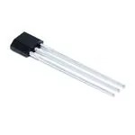{ width="150" } **Option 1.** TI DRV5055A1QLPG linear Hall-effect sensor (TO-92) $0.77/each [DRV5055A1QLPG at Mouser](https://www.mouser.com/ProductDetail/595-DRV5055A1QLPG) | * Analog output gives a continuous field-strength reading on the PIC ADC (RA0), which meets the project's analog signal chain requirement and lets the lid threshold be tuned in firmware * Runs from the 3.3 V rail (3.0 V to 3.63 V range), so its output (centered at 1.65 V) can never exceed the PIC's 3.3 V ADC input * TO-92 through-hole package is easy to hand-solder and to position next to the cap magnet * Low unit cost and a complete TI datasheet | * Output is ratiometric, so noise on the 3.3 V rail shows up directly in the reading and the supply needs local decoupling * Sensitivity drops to 60 mV/mT at 3.3 V (vs. 100 mV/mT at 5 V), giving less signal swing for the same magnet distance * Needs a comparator or a firmware threshold to turn the analog value into a clean open/closed signal |

| Solution | Pros | Cons |
|---|---|---|
| 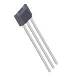{ width="150" } **Option 2.** Allegro A1324LUA-T linear Hall-effect sensor (TO-92) $2.01/each [A1324LUA-T at Mouser](https://www.mouser.com/ProductDetail/250-A1324LUA-T) | * Accurate ratiometric analog output (5 mV/G) with 17 kHz bandwidth, well suited to measuring cap position * Rated for -40 °C to 150 °C, far beyond anything a pill bottle will see * Same TO-92 through-hole package style as Option 1, so it is easy to solder | * Requires a 4.5 V to 5.5 V supply, so it cannot run from the 3.3 V rail, and its output (up to about 5 V) would need a divider before the PIC's 3.3 V ADC pin * Higher supply current (6.9 mA typical, 9 mA max) than Option 1 * Costs more than twice as much as Option 1, and Allegro lists the LUA-T as "contact factory for availability," which risks long lead times |

| Solution | Pros | Cons |
|---|---|---|
| 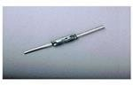{ width="150" } **Option 3.** Custom: Littelfuse MDSR-4-12-18 reed switch with pull-up resistor and RC low-pass debounce filter $1.44/each [MDSR-4-12-18 at Mouser](https://www.mouser.com/ProductDetail/934-MDSR-412-18) | * The switch itself draws no supply current; only the pull-up resistor draws current when the switch is closed * Simple digital open/closed output that can go straight to a PIC input after the RC debounce filter * Contacts are rated 0.5 A / 200 VDC, far above the 3.3 V logic signal they would switch | * On/off output only, so it does not meet the project's analog signal chain requirement and cannot detect a partly opened cap or a weak or missing magnet (LID_FAULT) * Glass envelope is fragile and can crack if the leads are bent close to the body during assembly * Mechanical contacts bounce and wear, so extra debounce parts are needed and lifetime is limited by the number of switching cycles |

**Choice:** Option 1: TI DRV5055A1QLPG linear Hall-effect sensor

**Rationale:** The DRV5055 is the only option that runs directly from the 3.3 V rail and still gives an analog output. Because its output stays between 0 V and 3.3 V, it connects straight to the PIC's ADC with no level shifting. The A1324 needs a 5 V supply and a divider on its output, costs more than twice as much, and has uncertain availability. The reed switch gives only an on/off signal, so it does not meet the analog front-end requirement. The analog reading also lets firmware flag LID_FAULT when the field is outside the expected open/closed range, for example when the magnet is missing. The TO-92 package is easy to hand-solder.

---

## 2. Comparator

**Subsystem: Board B – Cap / Lid Sensing**

| Solution | Pros | Cons |
|---|---|---|
| 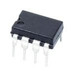{ width="150" } **Option 1.** TI LM393P dual voltage comparator (PDIP-8) $0.53/each [LM393P at Mouser](https://www.mouser.com/ProductDetail/595-LM393P) | * Operates from 2 V to 30 V, so it runs from the same 3.3 V rail as the Hall sensor * Open-collector output is pulled up to 3.3 V, so the signal into the PIC (RB0) is always at a safe logic level * Dual comparator in a PDIP-8 through-hole package that is easy to hand-solder * Low supply current (0.45 mA typical, 1 mA max at 5 V) and made by several manufacturers, so it is easy to source | * Input common-mode range only reaches VCC - 1.5 V (about 1.8 V on a 3.3 V supply), so the switching threshold must sit below 1.8 V * Needs an external pull-up resistor on the output, plus feedback resistors to add hysteresis * Rated for 0 °C to 70 °C only, which is fine indoors but narrower than the other options |

| Solution | Pros | Cons |
|---|---|---|
| 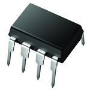{ width="150" } **Option 2.** Microchip MCP6541-I/P push-pull comparator (PDIP-8) $0.54/each [MCP6541-I/P at Mouser](https://www.mouser.com/ProductDetail/Microchip-Technology/MCP6541-I-P) | * Rail-to-rail inputs and output, so the threshold can be anywhere in the sensor's 0 V to 3.3 V output range * Push-pull output drives the PIC input directly with no pull-up resistor * Very low quiescent current (about 600 nA typical) * PDIP-8 through-hole package that is easy to hand-solder | * Single comparator per package, so a second channel would need another IC * Supply is limited to 1.6 V to 5.5 V, which gives less flexibility than the LM393 * Push-pull output cannot be pulled up to a different logic level or wired together with other outputs |

| Solution | Pros | Cons |
|---|---|---|
| 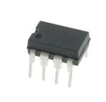{ width="150" } **Option 3.** Custom: Microchip MCP6002-I/P op-amp wired as a Schmitt-trigger comparator (PDIP-8) $0.45/each [MCP6002-I/P at Mouser](https://www.mouser.com/ProductDetail/Microchip-Technology/MCP6002-I-P) | * Threshold and hysteresis are set by resistors, so they can be tuned to the magnet distance in our cap * Rail-to-rail input and output and a 1.8 V to 6 V supply range, so it runs from the 3.3 V rail * Same Microchip MCP600x op-amp family used in our resistive sensor lab, so the team already knows the part | * Op-amps are not designed to run in saturation; their slow recovery and 0.6 V/µs slew rate give slower, less clean edges than a true comparator * Needs more external resistors to design, place, and debug * No built-in hysteresis, so a wrong resistor value can make the output chatter when the cap is near the threshold |

**Choice:** Option 1: TI LM393P dual voltage comparator

**Rationale:** The LM393 meets every Board B requirement once the threshold is kept inside its input range. The DRV5055 outputs 1.65 V with no magnet, and its output drops when a north pole faces the sensor. With the cap magnet mounted north-pole-down, the output moves between about 1.65 V (cap open) and well below that (cap closed). A threshold of about 1 V therefore stays inside the LM393's 0 V to 1.8 V common-mode range. The open-collector output with a pull-up to 3.3 V guarantees a safe logic level on RB0. Several manufacturers make the LM393, which protects the build schedule from stock shortages. The MCP6541 is the backup if the common-mode limit causes problems during testing. The op-amp Schmitt trigger was rejected because it needs more parts and switches more slowly than a dedicated comparator.

---

## 3. 5 V Voltage Regulator

**Subsystem: Board B – Cap / Lid Sensing (power)**

| Solution | Pros | Cons |
|---|---|---|
| 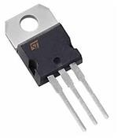{ width="150" } **Option 1.** STMicroelectronics L7805CV 5 V linear regulator (TO-220) $0.60/each [L7805CV at Mouser](https://www.mouser.com/ProductDetail/511-L7805CV) | * Fixed 5 V output rated up to 1.5 A, far more than Board B needs * Built-in current limiting and thermal shutdown protect the board from wiring mistakes during bring-up * TO-220 through-hole package is easy to solder; at 100 mA from 9 V it dissipates only 0.4 W, so it needs no heatsink * Linear regulator as the course requires, stable with small input and output capacitors | * About 2 V dropout means the input must stay above roughly 7 V, which rules out running long from a 9 V battery * Quiescent current of a few milliamps is wasted as heat * Only about 56 % efficient from a 9 V input (5 V / 9 V); the rest is lost as heat |

| Solution | Pros | Cons |
|---|---|---|
| 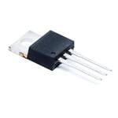{ width="150" } **Option 2.** TI LM2940CT-5.0/NOPB 5 V low-dropout regulator (TO-220) $2.04/each [LM2940CT-5.0 at Mouser](https://www.mouser.com/ProductDetail/926-LM2940CT-5.0NOPB) | * Low dropout (0.5 V typical at 1 A) lets it keep regulating from a lower input voltage * Reverse-polarity protection (-15 V typical) survives a supply plugged in backwards * Over 1 A output in a TO-220 through-hole package | * Needs an output capacitor of at least 22 µF with ESR between 0.1 Ω and 1 Ω, or it can oscillate * High quiescent current (10 mA typical at a 5 mA load), which is more than the Hall sensor and comparator draw combined * More than three times the cost of Option 1 |

| Solution | Pros | Cons |
|---|---|---|
| 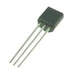{ width="150" } **Option 3.** Microchip MCP1702-5002E/TO 5 V low-dropout regulator (TO-92) $0.65/each [MCP1702-5002E/TO at Mouser](https://www.mouser.com/ProductDetail/Microchip-Technology/MCP1702-5002E-TO) | * Extremely low quiescent current (2 µA typical) * Low dropout (625 mV typical at 250 mA) * Stable with small 1 µF ceramic capacitors and takes up little board space | * Rated for only 250 mA output, with little margin if more 5 V loads are added later * Maximum input voltage is 13.2 V, so there is little headroom for supply spikes or a higher-voltage adapter * TO-92 package cannot shed much heat: (9 V - 5 V) × 250 mA = 1 W, which is far too much for TO-92 |

**Choice:** Option 1: STMicroelectronics L7805CV

**Rationale:** Board B runs from a 9 V wall supply, so the L7805's 2 V dropout and few-milliamp quiescent current don't matter. 9 V leaves 4 V of headroom, twice the dropout. At Board B's low current the TO-220 package runs cool with no heatsink. Built-in current limiting and thermal shutdown protect the board during bring-up. It is also the least expensive option and is widely stocked. The LM2940 costs more than three times as much, has strict output-capacitor ESR limits, and draws more quiescent current, and its low-dropout advantage isn't needed with a 9 V input. The MCP1702 is limited to 250 mA and cannot dissipate the heat of a 4 V drop at higher currents.

---

## 4. Power Source

**Subsystem: Board B – Cap / Lid Sensing (power)**

| Solution | Pros | Cons |
|---|---|---|
| 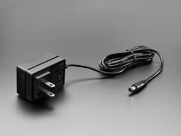{ width="150" } **Option 1.** Adafruit 9 VDC 1000 mA regulated switching wall adapter $8.95/each [9 V 1 A adapter at Adafruit](https://www.adafruit.com/product/63) | * Regulated 9 V stays above the L7805's roughly 7 V minimum input while keeping regulator heat low * 5.5 mm / 2.1 mm center-positive plug mates with the PJ-102AH barrel jack on Board B * UL listed with a universal 100–240 VAC input * Gives continuous power to a dispenser that sits on a counter all day | * Tied to a wall outlet, so the board does not run during a power outage * The most expensive item on Board B * Adafruit gives a specification list rather than a full manufacturer datasheet |

| Solution | Pros | Cons |
|---|---|---|
| 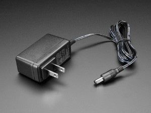{ width="150" } **Option 2.** Adafruit 12 VDC 1000 mA regulated switching wall adapter $8.95/each [12 V 1 A adapter at Adafruit](https://www.adafruit.com/product/798) | * Same 5.5 mm / 2.1 mm center-positive plug, so it mates with the same barrel jack * More input headroom above the regulator's dropout * Regulated, UL listed, 1 A output | * The L7805 must drop 7 V instead of 4 V, so it makes 75 % more heat for the same load current * Listed as out of stock at the time of writing, which risks the build schedule * Extra voltage brings no benefit, since nothing on Board B needs more than 5 V |

| Solution | Pros | Cons |
|---|---|---|
| 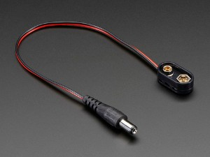{ width="150" } **Option 3.** 9 V alkaline battery (Energizer 522) with Adafruit 9 V battery clip and 5.5 mm / 2.1 mm plug $2.95/each (clip) + about $6.10/each (battery, Newark) [9 V clip at Adafruit](https://www.adafruit.com/product/80), [Energizer 522 datasheet](https://data.energizer.com/pdfs/522.pdf) | * Portable, with no outlet needed * The clip's center-positive barrel plug fits the same PJ-102AH jack, so no board change is needed * The clip is inexpensive and covers the battery terminals to prevent shorts | * Small capacity (about 600 mAh), and the voltage falls below the L7805's roughly 7 V minimum input long before the battery is empty, so battery life is short * Batteries must be bought again and again * A dispenser that quietly loses power could miss a dose reminder, which defeats the purpose of the product |

**Choice:** Option 1: Adafruit 9 VDC 1000 mA regulated wall adapter

**Rationale:** A pill dispenser stays in one place and must run reliably every day, so a wall adapter suits it better than a battery. A 9 V battery would drop below the L7805's minimum input early in its discharge. 9 V is the lowest standard adapter voltage that still clears the regulator's 2 V dropout with margin, so it keeps regulator heat lower than the 12 V adapter would. Its 1 A rating is far above what Board B draws. Its 5.5 mm / 2.1 mm plug mates with the PJ-102AH barrel jack already in the block diagram. It is regulated and UL listed, and it is in stock. The 12 V adapter is not.

---

## Pin Table

**Subsystem: Board B – Cap / Lid Sensing** (PIC18F57Q43 Curiosity Nano)

| MCU Pin | Peripheral / Mode | Direction | Connected To | Signal | Ribbon J1 Pin |
|---|---|---|---|---|---|
| RA0 | ADC (analog input) | Input | DRV5055 OUT | Hall sensor analog voltage | — |
| RB0 | Digital input | Input | LM393 output (pull-up to 3.3 V) | Lid open/closed (comparator) | — |
| RC5 | Digital output | Output | Status LED | Local lid status | — |
| RD0 | Digital input | Input | Hub J2 | DOSE_READY (Hub → Board B) | 1 |
| RD1 | Digital output | Output | Hub J2 | LID_OPEN (Board B → Hub) | 2 |
| RD2 | Digital output | Output | Hub J2 | LID_FAULT (Board B → Hub) | 3 |
| RD4 | Digital output | Output | Hub J2 | HEARTBEAT_B (Board B → Hub) | 5 |
| VBUS | 5 V power | Input | L7805CV output | 5 V rail | — |
| VTG | 3.3 V power | Output | DRV5055 VCC, LM393 VCC | 3.3 V rail | — |
| GND | Ground | — | Board ground, Hub ground | GND | 8 |

J1 pins 4, 6, and 7 are spare.
