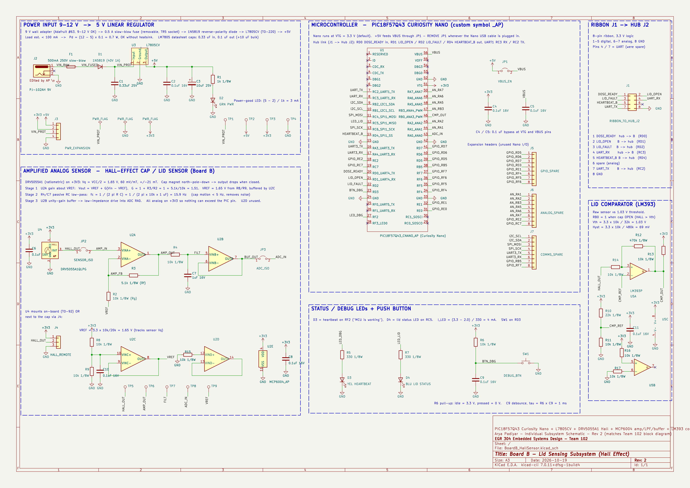

**Arya Padiyar | Team 102 | Board B: Cap / Lid Sensing**

## Overview

**Figure 1:** Board B (Cap / Lid Sensing) subsystem schematic.

Board B detects when the pill bottle cap is opened. A magnet in the cap is sensed by a linear Hall-effect sensor. The signal is amplified, filtered and read by the PIC's ADC, and an LM393 comparator also gives a clean open/closed signal. The board reports to the hub over the team's 8-pin ribbon cable.

---

## Power

| Item | Part | Notes |
|---|---|---|
| Input | Same Sky PJ-102AH barrel jack (J2) | 9 V wall adapter (Adafruit #63); accepts 9–12 V |
| Fuse | 500 mA slow-blow, TR5 socket (F1) | Removable |
| Reverse protection | 1N5819 Schottky (D1) | |
| Regulator | STMicroelectronics L7805CV, TO-220 (U3) | 0.33 µF in, 0.1 µF + 10 µF out, per datasheet |
| 5 V → Nano | Jumper JP1 to VBUS | Remove JP1 when the Nano's USB cable is plugged in |
| 3.3 V rail | Curiosity Nano VTG | Powers all analog parts, so no signal can exceed the PIC's pin limits |

Load is under 100 mA, so the L7805 dissipates at most (12 − 5) × 0.1 = 0.7 W and needs no heatsink.

## Amplified analog sensor

| Stage | Parts | Design |
|---|---|---|
| Sensor | TI DRV5055A1QLPG (U4), custom symbol `DRV5055A1_AP` | Ratiometric on 3.3 V: 1.65 V with no field, 60 mV/mT |
| Reference | R8/R9 10k divider, buffered by MCP6004 channel C | VREF = 1.65 V, tracks the sensor's zero-field output |
| Gain | MCP6004 channel A, non-inverting about VREF | G = 1 + R3/R2 = 1 + 5.1k/10k ≈ 1.5 |
| Low-pass filter | R4 = 10 kΩ, C7 = 1 µF | fc = 1 / (2π·R·C) ≈ 15.9 Hz |
| Buffer | MCP6004 channel B, unity gain | Low-impedance drive into ADC pin RA0 |
| Isolation | JP2 (sensor), JP3 (ADC) | Lets each stage be tested on its own |

The sensor can sit on the board (TO-92) or near the cap through header J4.

## Lid comparator

| Item | Value |
|---|---|
| Part | TI LM393P (U5) |
| Input | Raw sensor output vs. a 1.03 V threshold (R10 22k / R11 10k) |
| Hysteresis | R14 10k / R12 470k ≈ 69 mV |
| Output | Open collector, 10k pull-up to 3.3 V, to RB0 |
| Logic | RB0 = 1 when the cap is open |

## Pin table (PIC18F57Q43 Curiosity Nano)

| MCU pin | Mode | Direction | Connected to | Signal | Ribbon J1 pin |
|---|---|---|---|---|---|
| RA0 | ADC | In | Buffered, filtered sensor | ADC_IN | — |
| RB0 | Digital | In | LM393 output | CMP_OUT (cap open/closed) | — |
| RC5 | Digital | Out | Lid status LED (D4) | LED_LID | — |
| RF2 | Digital | Out | Heartbeat debug LED (D3) | LED_DBG | — |
| RD3 | Digital | In | Debug button SW1, 10k pull-up | BTN_DBG | — |
| RD0 | Digital | In | Hub | DOSE_READY | 1 |
| RD1 | Digital | Out | Hub | LID_OPEN | 2 |
| RD2 | Digital | Out | Hub | LID_FAULT | 3 |
| RC3 | UART1 RX | In | Hub | UART_RX | 4 |
| RD4 | Digital | Out | Hub | HEARTBEAT_B | 5 |
| RC2 | UART1 TX | Out | Hub | UART_TX | 7 |
| GND | — | — | Hub | GND | 8 |

Ribbon pin 6 is spare. Unused Nano pins are broken out to expansion headers J5 (GPIO), J6 (analog) and J7 (I²C/SPI/UART3).

## Debug and test features

- Heartbeat LED (D3) and lid status LED (D4), 330 Ω each: (3.3 − 2.0) / 330 ≈ 4 mA
- Push button SW1 with 10k pull-up and 0.1 µF debounce capacitor
- Test points TP1–TP9 on every power rail and every analog stage
- Jumpers JP1–JP3 for isolating sections during debugging
- Power expansion header J3 (VIN, 5 V, 3.3 V, GND)
- 0.1 µF bypass capacitor on every power pin
- Unused op-amp (U2D) and comparator (U5B) inputs tied off through 10k pull-up/pull-down resistors
- Every capacitor lists a working voltage (≥25% margin) and every resistor a power rating (1/8 W, ≥50% margin)

Schematic checked in KiCad 10: 0 ERC errors, 0 warnings.

## Resources

The schematic as a PDF download is available [*here*](BoardB_HallSensor_Schematic.pdf), and the Zip folder of the KiCad project (including custom symbol and footprint libraries) [*here*](AryaPadiyar_BoardB_Schematic_Project.zip).
