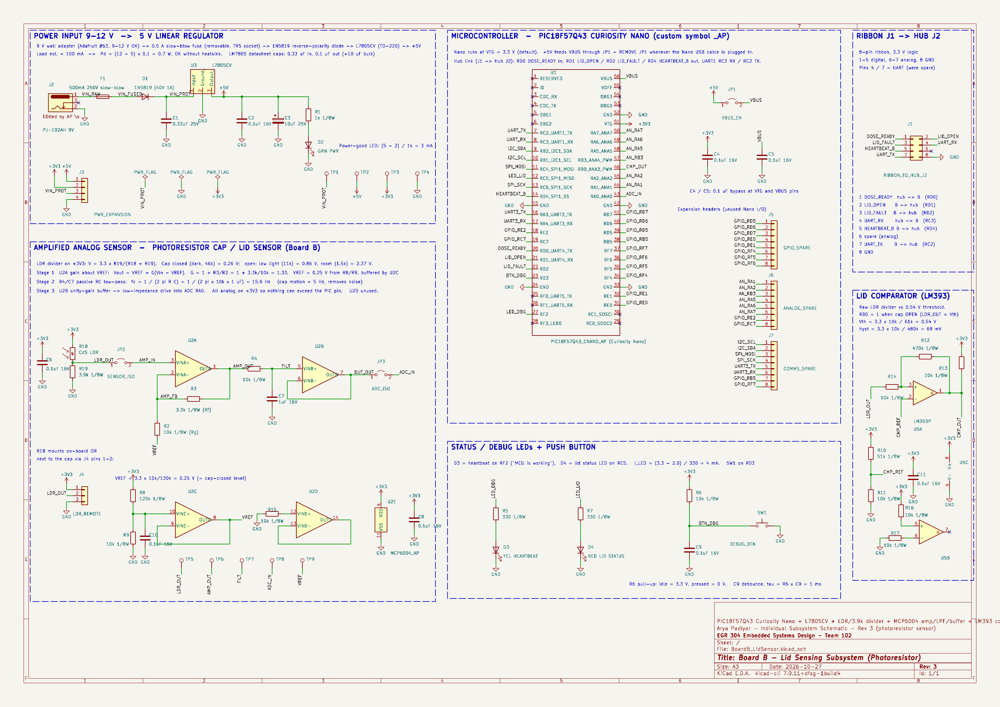

**Arya Padiyar | Team 102 | Board B: Cap / Lid Sensing | Rev 3**

## Overview

**Figure 1:** Board B (Cap / Lid Sensing) subsystem schematic, Rev 3.

Board B detects when the pill bottle cap is opened. A photoresistor sits under the cap: with the cap closed it is dark, and when the cap opens light reaches it, its resistance drops and the divider voltage rises. The signal is amplified, filtered and read by the PIC's ADC, and an LM393 comparator also gives a clean open/closed signal. The board reports to the hub over the team's 8-pin ribbon cable.

> **Rev 3 (Oct 27):** the DRV5055 Hall-effect sensor and cap magnet were replaced by a photoresistor (R18) and a 3.9 kΩ divider resistor (R19), as recommended by the teaching team. The gain, reference and comparator-threshold resistors were re-calculated for the new signal range. Everything else is unchanged from Rev 2.

---

## Power

| Item | Part | Notes |
|---|---|---|
| Input | Same Sky PJ-102AH barrel jack (J2) | 9 V wall adapter (Adafruit #63); accepts 9–12 V |
| Fuse | 500 mA slow-blow, TR5 socket (F1) | Removable |
| Reverse protection | 1N5819 Schottky (D1) | |
| Regulator | STMicroelectronics L7805CV, TO-220 (U3) | 0.33 µF in, 0.1 µF + 10 µF out, per datasheet |
| 5 V → Nano | Jumper JP1 to VBUS | Remove JP1 when the Nano's USB cable is plugged in |
| 3.3 V rail | Curiosity Nano VTG | Powers all analog parts, so no signal can exceed the PIC's pin limits |

Load is under 100 mA, so the L7805 dissipates at most (12 − 5) × 0.1 = 0.7 W and needs no heatsink.

## Amplified analog sensor

| Stage | Parts | Design |
|---|---|---|
| Sensor | CdS photoresistor R18 (custom symbol `LDR_AP`, footprint `AP_R_LDR_5.0x4.1mm_P3mm`) + R19 = 3.9 kΩ to GND | V = 3.3 × R19 / (R18 + R19): 0.26 V cap closed (46.3 kΩ dark), 0.86 V low light (11.07 kΩ), 2.37 V room light (1.54 kΩ) |
| R19 choice | Geometric mean of the lab readings | √(11.07k × 1.54k) ≈ 4.1 kΩ → 3.9 kΩ standard value, maximizes the swing between low and room light |
| Reference | R8 = 120 kΩ / R9 = 10 kΩ divider, buffered by MCP6004 channel C | VREF = 3.3 × 10k / 130k ≈ 0.25 V, set to the cap-closed level |
| Gain | MCP6004 channel A, non-inverting about VREF | G = 1 + R3/R2 = 1 + 3.3k/10k ≈ 1.33, so ADC sees ≈ 0.26 V closed, 1.06 V low light, 3.07 V room light |
| Low-pass filter | R4 = 10 kΩ, C7 = 1 µF | fc = 1 / (2π·R·C) ≈ 15.9 Hz |
| Buffer | MCP6004 channel B, unity gain | Low-impedance drive into ADC pin RA0 |
| Isolation | JP2 (sensor), JP3 (ADC) | Lets each stage be tested on its own |

The photoresistor can sit on the board or next to the cap through header J4 (pin 1 = 3.3 V, pin 2 = LDR_OUT); R19 stays on the board.

## Lid comparator

| Item | Value |
|---|---|
| Part | TI LM393P (U5) |
| Input | Raw divider output (LDR_OUT) vs. a 0.54 V threshold (R10 51k / R11 10k), inside the LM393's 0–1.8 V input range on 3.3 V |
| Hysteresis | R14 10k / R12 470k ≈ 69 mV |
| Output | Open collector, 10k pull-up to 3.3 V, to RB0 |
| Logic | RB0 = 1 when the cap is open |

## Pin table (PIC18F57Q43 Curiosity Nano)

| MCU pin | Mode | Direction | Connected to | Signal | Ribbon J1 pin |
|---|---|---|---|---|---|
| RA0 | ADC | In | Buffered, filtered light level | ADC_IN | — |
| RB0 | Digital | In | LM393 output | CMP_OUT (cap open/closed) | — |
| RC5 | Digital | Out | Lid status LED (D4) | LED_LID | — |
| RF2 | Digital | Out | Heartbeat debug LED (D3) | LED_DBG | — |
| RD3 | Digital | In | Debug button SW1, 10k pull-up | BTN_DBG | — |
| RD0 | Digital | In | Hub | DOSE_READY | 1 |
| RD1 | Digital | Out | Hub | LID_OPEN | 2 |
| RD2 | Digital | Out | Hub | LID_FAULT | 3 |
| RC3 | UART1 RX | In | Hub | UART_RX | 4 |
| RD4 | Digital | Out | Hub | HEARTBEAT_B | 5 |
| RC2 | UART1 TX | Out | Hub | UART_TX | 7 |
| GND | — | — | Hub | GND | 8 |

Ribbon pin 6 is spare. Unused Nano pins are broken out to expansion headers J5 (GPIO), J6 (analog) and J7 (I²C/SPI/UART3).

## Debug and test features

- Heartbeat LED (D3, yellow) and lid status LED (D4, red), 330 Ω each: (3.3 − 2.0) / 330 ≈ 4 mA
- Push button SW1 with 10k pull-up and 0.1 µF debounce capacitor
- Test points TP1–TP9 on every power rail and every analog stage
- Jumpers JP1–JP3 for isolating sections during debugging
- Power expansion header J3 (VIN, 5 V, 3.3 V, GND)
- 0.1 µF bypass capacitor on every power pin
- Unused op-amp (U2D) and comparator (U5B) inputs tied off through 10k pull-up/pull-down resistors
- Every capacitor lists a working voltage (≥25% margin) and every resistor a power rating (1/8 W, ≥50% margin)

Rev 2 passed ERC in KiCad 10 with 0 errors and 0 warnings. Rev 3 only changes the sensor parts and resistor values; its netlist was compared with Rev 2 and the only differences are U4 → R18/R19 and the HALL_OUT → LDR_OUT net name.

## How the schematic meets the product requirements

| User need / requirement | Circuit that meets it |
|---|---|
| Know when the cap is opened | R18/R19 divider → LM393 comparator (with ≈ 69 mV hysteresis) → RB0 → LID_OPEN on ribbon pin 2 |
| Analog signal chain into the ADC | R18/R19 → U2A gain about VREF → R4/C7 15.9 Hz low-pass → U2B buffer → RA0 |
| Detect a problem (sensor unplugged, dark room, cap never opened during a dose) | Firmware compares the ADC level, comparator state and DOSE_READY and drives LID_FAULT on pin 3 |
| Work with the rest of the dispenser | 8-pin ribbon J1: DOSE_READY in, LID_OPEN / LID_FAULT / HEARTBEAT_B out, UART1 both ways |
| Safe, reliable power | 9 V adapter → 500 mA fuse → 1N5819 → L7805CV → 5 V VBUS (JP1); all analog on the Nano's 3.3 V rail |
| Easy to test and debug | TP1–TP9 on every rail and analog stage, JP1–JP3 isolation jumpers, heartbeat LED, debug button, expansion headers J3, J5–J7 |

## Resources

The schematic as a PDF download is available [*here*](BoardB_LidSensor_Schematic.pdf), and the Zip folder of the KiCad 10 project (including the custom `AP_Symbols` symbol library and `AP_Footprints` footprint library) [*here*](AryaPadiyar_BoardB_Schematic_Project.zip).
