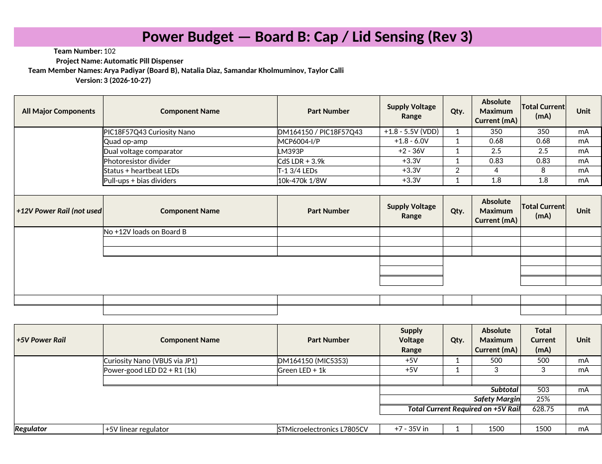
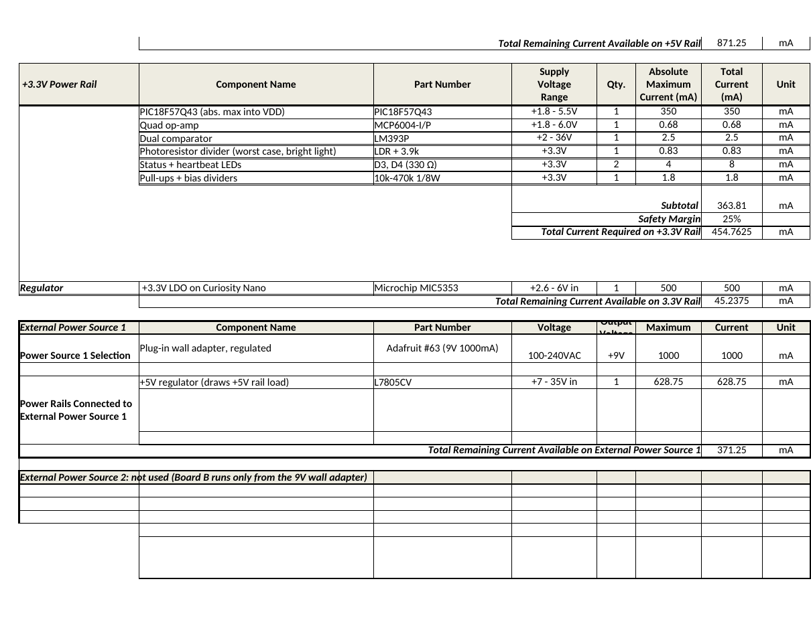
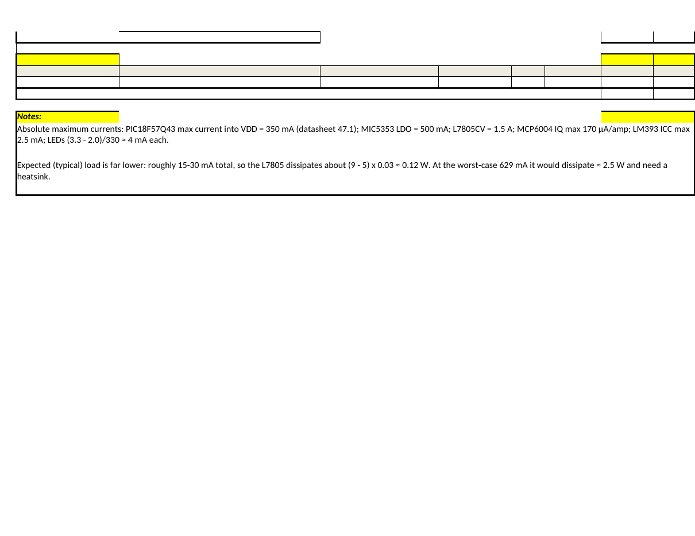

**Arya Padiyar | Team 102 | Board B: Cap / Lid Sensing | Rev 3**

## Overview

Board B runs from a 9 V, 1 A wall adapter. The power path is 9 V adapter → 500 mA fuse + 1N5819 reverse-polarity diode → STMicroelectronics L7805CV → 5 V on the Curiosity Nano's VBUS (through jumper JP1) → the Nano's on-board MIC5353 LDO → 3.3 V for the PIC and every analog part. The budget below uses the course power budget template and the absolute maximum (worst-case) current of each part, with a 25 % safety margin on each rail.

Downloads: [power budget spreadsheet (.xlsx)](BoardB_Power_Budget.xlsx) · [PDF](BoardB_Power_Budget.pdf)

## Summary

| Rail | Source | Max available | Worst-case required (incl. 25 % margin) | Remaining |
|---|---|---|---|---|
| +3.3 V | MIC5353 LDO on the Curiosity Nano | 500 mA | 454.8 mA | 45.2 mA |
| +5 V | L7805CV | 1500 mA | 628.8 mA | 871.3 mA |
| +9 V input | Adafruit #63 wall adapter | 1000 mA | 628.8 mA | 371.3 mA |

### +3.3 V rail loads

| Component | Part number | Qty | Max current (mA) | Total (mA) |
|---|---|---|---|---|
| Microcontroller (max current into VDD) | PIC18F57Q43 | 1 | 350 | 350 |
| Quad op-amp (gain, VREF buffer, ADC buffer) | MCP6004-I/P | 1 | 0.68 | 0.68 |
| Dual comparator | LM393P | 1 | 2.5 | 2.5 |
| Photoresistor divider, bright light | CdS LDR + 3.9 kΩ | 1 | 0.83 | 0.83 |
| Heartbeat + lid status LEDs (330 Ω) | D3, D4 | 2 | 4 | 8 |
| Pull-ups and bias dividers | R6, R8–R11, R13, R15–R17 | 1 | 1.8 | 1.8 |
| **Subtotal / with 25 % margin** | | | | **363.8 / 454.8** |

### +5 V rail loads

| Component | Part number | Qty | Max current (mA) | Total (mA) |
|---|---|---|---|---|
| Curiosity Nano through VBUS (limited by its 500 mA LDO) | DM164150 | 1 | 500 | 500 |
| Power-good LED + 1 kΩ | D2, R1 | 1 | 3 | 3 |
| **Subtotal / with 25 % margin** | | | | **503 / 628.8** |

## Budget pages

## What the power budget showed

- **Every rail has margin, even in the worst case.** The tightest is the 3.3 V rail, where the PIC's 350 mA absolute maximum dominates. Even with that and a 25 % margin, the load stays under the Nano's 500 mA LDO. In normal operation the PIC draws a few milliamps, so the real margin is much larger.
- **The 9 V, 1 A adapter is more than enough.** The worst-case draw is about 630 mA. The expected draw is roughly 15–30 mA (PIC, op-amp, comparator, two LEDs).
- **The L7805 needs no heatsink in normal use.** At the expected load it dissipates about (9 − 5) × 0.03 ≈ 0.12 W. Only at the theoretical worst case (≈ 630 mA) would it reach ≈ 2.5 W and need a heatsink, which the TO-220 package allows if it is ever needed.
- **Changing to the photoresistor cut the sensor current.** The LDR divider draws at most 0.83 mA (bright light) and about 0.07 mA with the cap closed.
- **Open question for the teaching team:** Microchip documents VBUS only as an output, so feeding 5 V into it through JP1 should be confirmed before the board is built. JP1 must be removed whenever the Nano's USB cable is plugged in.
