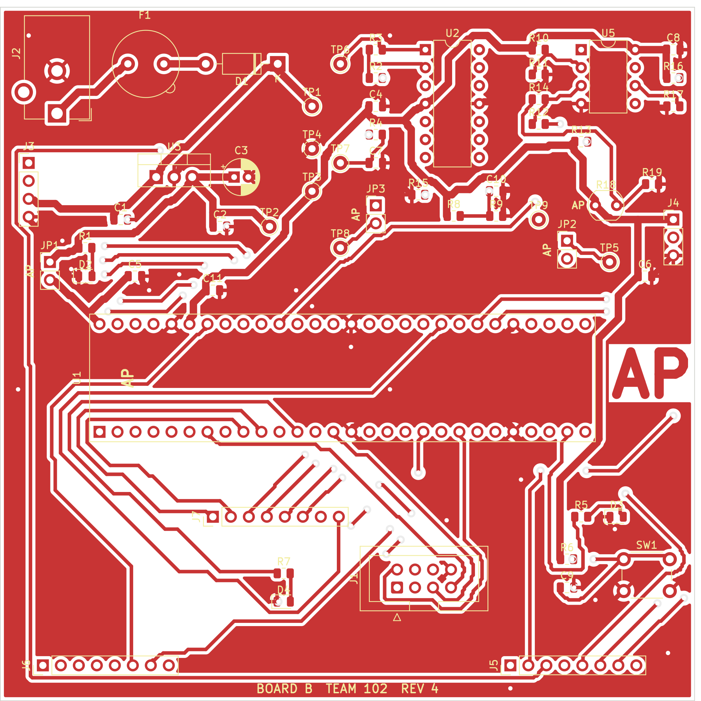
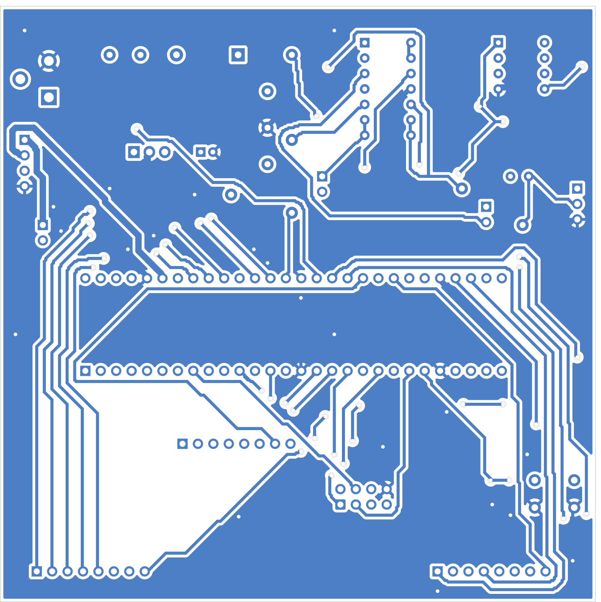

**Arya Padiyar | Team 102 | Board B: Cap / Lid Sensing | Rev 4**

## Overview

This page shows the printed circuit board for Board B, laid out in KiCad from the [Rev 4 schematic](../04-Schematic/schematic.md). It is a 98 mm x 98 mm two-layer board, designed to be milled on the LPKF ProtoMat S63 in Peralta Lab.

**Figure 1:** Top layer (F.Cu). Reference labels are shown for readability only; the milled board has no silkscreen.

**Figure 2:** Bottom layer (B.Cu), viewed from the top.

## Layout

I grouped the board the same way as the block diagram, so each signal path stays short:

- **Power (top left):** barrel jack J2 at the board edge, then fuse F1, reverse-polarity diode D1 and the L7805CV regulator U3, with its input and output capacitors right next to the pins. The 5 V rail reaches the Nano's VBUS through jumper JP1.
- **Analog chain (top right):** the photoresistor R18 and R19 divider feeds the MCP6004 (U2) gain stage, the R4/C7 low-pass filter and the buffer. The LM393 comparator (U5) and its threshold and hysteresis resistors sit beside it. Test points TP5 to TP9 are on every analog stage.
- **Curiosity Nano (middle):** the Nano runs across the board. Its top row faces the analog section (ADC_IN on RA0, CMP_OUT on RB0, 3.3 V on VTG). Its bottom row faces the connectors.
- **Connectors (bottom):** ribbon header J1 to the hub, the spare expansion headers J5 to J7, the status and heartbeat LEDs and the debug button.

## Design rules

| Rule | Value | Why |
|---|---|---|
| Copper layers | 2 (top and bottom), no soldermask or silkscreen | Peralta mill process |
| Board size | 98.1 mm x 98.1 mm | Under the 100 mm x 100 mm limit (measured in KiCad) |
| Minimum track / clearance | 0.381 mm (15 mil) | Peralta PCB Mill Specs |
| Signal tracks | 0.5 mm | |
| Power tracks (VIN, +5 V, +3.3 V, VBUS) | 1.05 mm | Board current is under 100 mA, far below the 500 mA limit that needs a trace-width calculation on 0.5 oz copper |
| Vias | 1.2 mm pad, 0.6 mm drill | Large enough to wire through by hand |
| Copper to board edge | 0.5 mm | |
| Ground planes | GND pour on top and bottom copper | Shielding and a low-impedance return path |
| Initials | "AP", 6 mm bold, on top copper | Assignment requirement |

The design passes KiCad's Design Rules Check with **0 violations and 0 unconnected items**.

## Footprints

Every footprint is in my custom `AP_Footprints` library and has my initials in its name. I made a new footprint for the Curiosity Nano, `AP_PIC18F57Q43_Curiosity_Nano_2x28_W15.24mm`: two 1x28 rows at 2.54 mm pitch, 0.6 in (15.24 mm) apart, with pin 1 and pin 56 at the USB end. The Nano plugs into two 1x28 female headers, so it can be removed for programming or replacement.

## Resources

- PDF of the top and bottom PCB layers: [*here*](BoardB_LidSensor_PCB_Layers.pdf)
- Zip of the KiCad project (schematic, PCB, `AP_Symbols` and `AP_Footprints` libraries): [*here*](AryaPadiyar_BoardB_PCB_Project.zip)
- Zip of the Gerber and drill files sent to Peralta: [*here*](AryaPadiyar102.zip)
